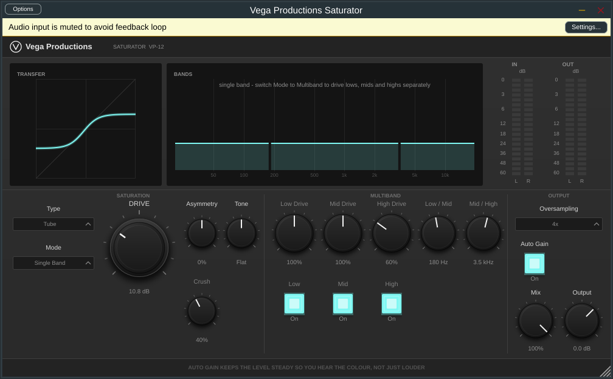

# Vega Productions Saturator (VP-12)

Multiband saturation for warmth, weight and loudness — the step before Vega Productions Mastering.



## Download
- **Windows (FL Studio):** https://github.com/DJVega70/vega-saturator/releases/latest/download/VegaProductions-Saturator-Windows-VST3.zip
- **macOS:** https://github.com/DJVega70/vega-saturator/releases/latest/download/VegaProductions-Saturator-macOS-VST3-AU.zip

## Features
- **7 types:** Tube, Tape, Console, Transistor, Fuzz, Wavefold, Bitcrush (with Crush control for bits + sample-rate reduction).
- **Drive** up to +36 dB with a live transfer-curve display.
- **Asymmetry** adds even harmonics (the "tube" warmth); **Tone** tilts dark ↔ bright after the saturation.
- **Multiband:** split into Low / Mid / High with phase-aligned Linkwitz-Riley crossovers, set drive per band (0–200%) and switch bands in/out — e.g. saturate the mids for presence while the sub stays clean.
- **Oversampling** Off / 2x / 4x / 8x to keep the highs free of aliasing (latency is reported to the host and compensated in the dry mix).
- **Auto Gain** keeps the level steady so you judge the colour, not the volume. Mix, Output, I/O meters, resizable.

## Building
```
cmake -B build -DVEGA_TESTS=ON
cmake --build build --config Release --target VegaSaturator_VST3 VegaSaturatorTest
```
